# CdVinylCatalog

Приложение-каталогизатор для личной коллекции CD, DVD, винила и аудиокассет.
Сканируйте штрихкод с диска — приложение найдёт релиз в базе Discogs
и покажет, есть ли он уже в вашей коллекции.

## Проблема

У меня имеется коллекция физических дисков и пластинок, но я не помню,
что именно у меня есть. Бывали случаи, когда я покупал диск в магазине,
а дома обнаруживал, что такой уже есть.

## Решение

1. Сканируете штрихкод с интересующего диска через камеру
2. Приложение ищет релиз в Discogs API
3. Показывает список изданий: исполнитель, альбом, год, формат
4. Помечает те издания, которые уже есть в вашей коллекции
5. Выбранный диск добавляется в локальную коллекцию

Если на диске нет штрихкода — есть ручной поиск по исполнителю и названию.
Если релиза нет в Discogs — его можно добавить вручную, с фотографиями обложки
и кадрированием.

## Технологии

- **Kotlin** + **Coroutines** + **Flow**
- **Jetpack Compose** — UI
- **MVI** — архитектурный паттерн (State / Intent / Effect)
- **Hilt** — dependency injection
- **Retrofit** + **OkHttp** + **Gson** — сеть
- **Room** — локальная база
- **Paging 3** — постраничная загрузка: и в Room, и в Discogs API
- **CameraX** + **ML Kit** — сканирование штрихкодов
- **Navigation Compose** — навигация
- **Coil** — загрузка обложек
- **uCrop** — кадрирование фотографий
- **Discogs API** — источник данных о релизах

## Архитектура

Проект построен на **фиче-ориентированной многомодульной архитектуре**
с **Clean Architecture** и разделением по слоям.

### Модули

```text
:app                    — точка входа, DI, навигация
:domain                 — Entities, порты репозиториев, Use Cases, AppError/Outcome
:data:network           — Retrofit, Discogs API, DTO, PagingSource, мапперы
:data:database          — Room, DAO, Entity, мапперы
:data:files             — реализация PhotoStorage: файлы фотографий, FileProvider
:common-ui              — тема, общие Compose-компоненты, UiMessage, маппинг AppError в текст
:feature:add            — сканирование, поиск, результаты, детали релиза, добавление вручную
:feature:collection     — коллекция: список с сортировкой и экран деталей
```

### Правила зависимостей

- Фичи зависят от `:domain` и `:common-ui`, но **не знают друг о друге**.
- `:domain` — чистый Kotlin-модуль (`java-library`), зависит от корутин,
  `paging-common` и `javax.inject`; никакого Android SDK.
- Реализации репозиториев живут в `:data:*`, интерфейсы — в `:domain`.
- Presentation-слой не знает о Retrofit, Room и сетевых исключениях.
- Если тип участвует в **публичном** API модуля (`Flow`, `PagingData`,
  `AppError`, `@Inject`), зависимость объявляется через `api(...)`, а не
  `implementation`, иначе потребитель не увидит эти типы при компиляции.
- Фичи не объявляют `:data:*` вообще — только `:domain` и `:common-ui`.
  Единственное место, где известны реализации, — `:app` (composition root).

### Что лежит в `:domain`

```text
:domain
├── catalog/       Release, Track, Format и правила над ними:
│                  mergeWith, parseFormat/parseStoredFormat,
│                  normalizeBarcode, galleryImages/remoteImages/localImages
├── collection/    CollectionItem, SortOrder + parseStoredSortOrder
├── media/         PhotoDestination + порт PhotoStorage
├── result/        Outcome, AppError, AppErrorException
├── repository/    Порты: CollectionReader/Writer/Membership, ReleaseRepository
└── usecase/       Use Cases — единственное место для бизнес-логики
    ├── catalog/
    └── collection/
```

Функции над моделями живут рядом с моделями, а не в UI-модулях:
`mergeWith` задаёт приоритет правок пользователя над Discogs, `parseFormat`
разбирает строку Discogs (`"CD, Album"`), `parseStoredFormat` и
`parseStoredSortOrder` восстанавливают значение из имени, сохранённого
в базе или Bundle. Восстановление сделано через `entries.firstOrNull`,
а не через `valueOf` в `try/catch`: неизвестное значение — не ошибка,
а штатная ситуация после смены набора значений.

### Изображения: три взгляда на одно поле

`Release.imageUrls` и `coverImageUrl` смешивают два разных вида ссылок:
URL из Discogs и абсолютные пути к файлам в хранилище приложения
(`filesDir/photos`). Три функции разводят их по источнику:

| Функция | Что возвращает |
|---|---|
| `galleryImages()` | всё для галереи: `imageUrls`, иначе хотя бы `coverImageUrl` |
| `remoteImages()` | только `http`-ссылки — их нельзя удалить с устройства |
| `localImages()` | только файлы — именно их удаляет `DeleteCollectionItemUseCase` |

Тождество: `galleryImages() == remoteImages() + localImages()`.

Соглашение «`http` = из сети, иначе файл» записано в одном месте —
в приватной `isRemoteImage`. Это компромисс: надёжнее было бы хранить
удалённые и локальные картинки в двух разных полях модели, но это
изменение схемы и миграция.

### Что лежит в `:common-ui`

```text
:common-ui
├── Theme.kt / Type.kt / Color.kt   Тёмная тема Material 3, динамические цвета
├── OrientationHandler.kt           Ориентация: портрет на телефоне, свободная на планшете
├── AppErrorExt.kt                  AppError → строка (asText)
├── message/                        UiMessage и маппинг AppError
└── component/
    ├── DiscCard.kt                 Карточка диска для всех списков
    ├── CoverGallery.kt             Галерея обложек с перелистыванием
    ├── CoverPlaceholder.kt         Заглушка, когда обложки нет
    ├── ReleaseInfo.kt              Обложки + заголовок + метаданные + треклист
    ├── ReleaseHeader.kt            Название и исполнитель
    ├── ReleaseMetadata.kt          Год, формат, лейбл, страна, каталог, заметка
    ├── MetadataRow.kt              Одна строка «лейбл — значение»
    ├── TracklistSection.kt         Секция треклиста в карточке
    ├── TrackRow.kt                 Один трек: позиция, название, длительность
    └── CdTopBar.kt                 Топ-бар: заголовок, «назад», действия
```

Общие экраны собираются из блоков, а не копируются:

- `ReleaseInfo` — общая часть обоих экранов деталей (релиз из Discogs
  и запись коллекции). Своё каждый экран добавляет хвостовым слотом:
  кнопки и заметку — `:feature:add`, «другие копии» — `:feature:collection`.
- `CdTopBar` заменяет `TopAppBar` с `navigationIcon` и `ArrowBack` на всех
  экранах; `onBack = null` — экран без кнопки «назад».

В блоках экранов деталей стиль фиксирован, а не параметризуется: в `ReleaseInfo`
нет `titleStyle` или `inCards`. Настройка — сам набор переданных полей
(передано — рисуется, `null` — пропускается), без флагов вида
`showLabel`/`showCountry`. Иначе два экрана одного назначения снова
разъезжаются по стилю. Размер обложки в `DiscCard` — осознанное исключение:
в поиске нужна крупнее, в коллекции компактнее.

Приложение **намеренно только тёмное**: светлая палитра не проектировалась,
а обложки на тёмном фоне читаются лучше. Поэтому у `CdVinylCatalogTheme`
нет параметра `darkTheme`, а системные панели в `MainActivity` зафиксированы
тёмными. Отсутствие светлой темы — не недоделка: переключатель появится
вместе с экраном настроек.


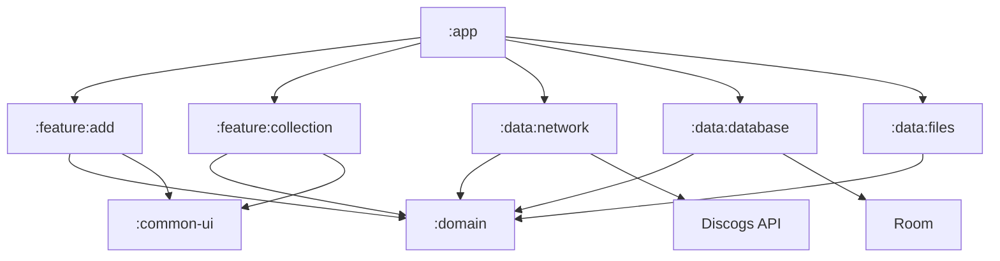

### MVI

Каждая фича следует MVI:

- **State** — единый неизменяемый снимок UI
- **Intent** — действия пользователя
- **Effect** — одноразовые события (Toast, навигация)

`PagingData` живёт **вне** State: это бесконечный поток, его нельзя класть
в `data class` состояния. Он выносится отдельным `StateFlow` и собирается
в UI через `collectAsLazyPagingItems()`.

### Обработка ошибок

Единый конвейер, одинаковый для обычных запросов и для пагинации:

```text
Исключение (UnknownHostException, HttpException, ...)
        │
        ▼   mapExceptionToAppError()  — единственное место маппинга, :data:network
   AppError (sealed interface в :domain)
        │
        ▼   AppErrorException — транспортная обёртка для Paging 3
LoadResult.Error / Outcome.Failure
        │
        ▼   asText(context)  — маппинг в строки, :common-ui
      Текст для пользователя
```

Presentation-слой оперирует только `AppError` и строковыми ресурсами,
поэтому замена Discogs на другой источник данных не затронет UI.

### Пагинация

- **Локальная коллекция** — `Room` отдаёт `PagingSource` напрямую, `Pager`
  создаётся в `CollectionRepositoryImpl`. Смена сортировки пересоздаёт
  `PagingSource` через `flatMapLatest`.
- **Сеть** — `DiscogsSearchPagingSource` параметризован штрихкодом или
  поисковой строкой и использует блок `pagination` из ответа Discogs,
  чтобы не делать лишний запрос за пределами последней страницы.
  Поиск Discogs умеет возвращать один и тот же релиз несколько раз, поэтому
  источник дедуплицирует результаты по `release.id` (иначе падает
  `LazyColumn`, у которого ключ — ID релиза).
- Потоки кэшируются в `viewModelScope` (`cachedIn`), поэтому поворот экрана
  не приводит к повторной загрузке.

### Схема базы и миграции

Схема Room экспортируется в `:data/database/schemas/`: при сборке Room
пишет JSON-описание таблиц, и эти файлы коммитятся.

Правило: **поменял сущность — подними `version` и добавь миграцию.**
Простое изменение (новая nullable-колонка, новая таблица) закрывается
`autoMigrations = [AutoMigration(from = N, to = N + 1)]`, переименование
колонки или смена типа — ручным `Migration(N, N + 1)`.

Разрушительного отката нет намеренно: забытая миграция роняет приложение
с явной ошибкой, а не стирает коллекцию пользователя. Экспортированная
схема — то, с чем миграция сравнивается, и без неё auto-migrations
невозможны в принципе.

### Резервное копирование

Политика разная для облака и для переноса по кабелю:

| Файл | API | Облако | Перенос |
|---|---|:---:|:---:|
| `xml/backup_rules.xml` | 26–27 | база | база |
| `xml-v28/backup_rules.xml` | 28–30 | база | база + фото |
| `xml/data_extraction_rules.xml` | 31+ | база | база + фото |

Причина разделения — квота облачной копии: **25 МБ на приложение**.
При превышении копия не создаётся **целиком**, вместе с базой, и
системного уведомления об этом нет. Одно фото проходит через uCrop
с `maxResultSize = 1080×1080`, это 150–400 КБ; до пяти фото на диск
дают до 2 МБ на запись, так что коллекция из десятка дисков с фото
в квоту не влезает. Перенос по кабелю лимита не имеет.

На API 28–30 разделение работает через `requireFlags="deviceToDeviceTransfer"`
(атрибут появился в Android 9). На API 26–27 его нет, поэтому там фото
не копируются вовсе — выбор в пользу базы.

Проверить на устройстве:

```bash
adb shell bmgr backupnow com.kai.cdvinylcatalog
```

### Навигация

Результаты поиска передаются между экранами **аргументами маршрута**
(`selection/{source}/{query}`), а не через общее состояние. Это переживает
поворот экрана и восстановление процесса. Сам поиск выполняется
в `ReleaseSelectionViewModel` — экраны сканера и ручного поиска только
передают строку запроса.

## Скриншоты

| Главный экран | Сканирование |
|:---:|:---:|
| 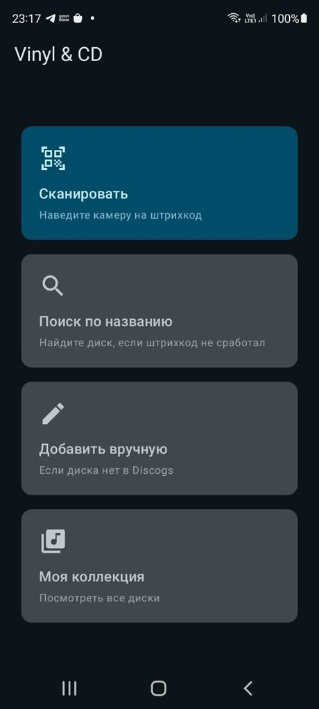 | 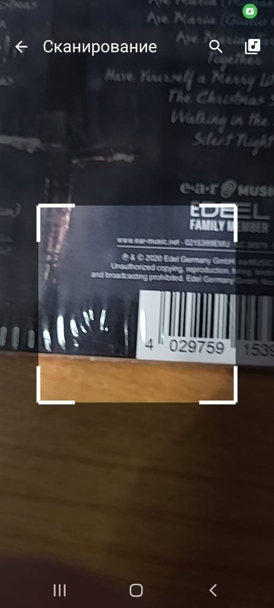 |
| Точка входа: сканер, поиск, ручное добавление, коллекция | Штрихкод распознаётся камерой через ML Kit |

| Ручной поиск | Результаты из Discogs |
|:---:|:---:|
| 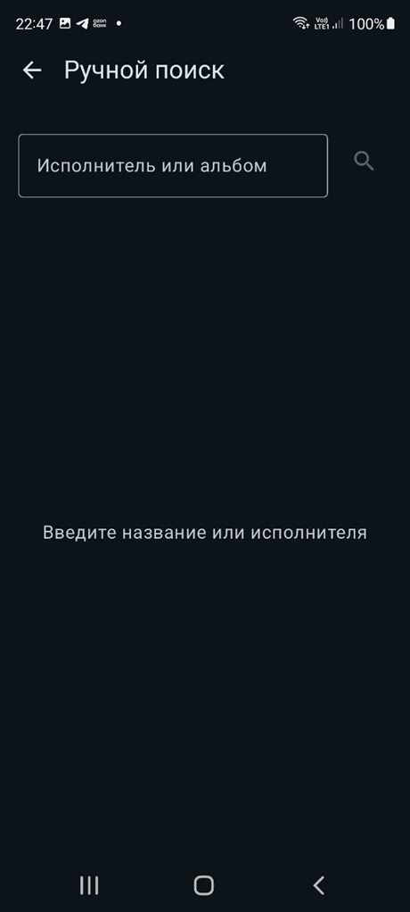 | 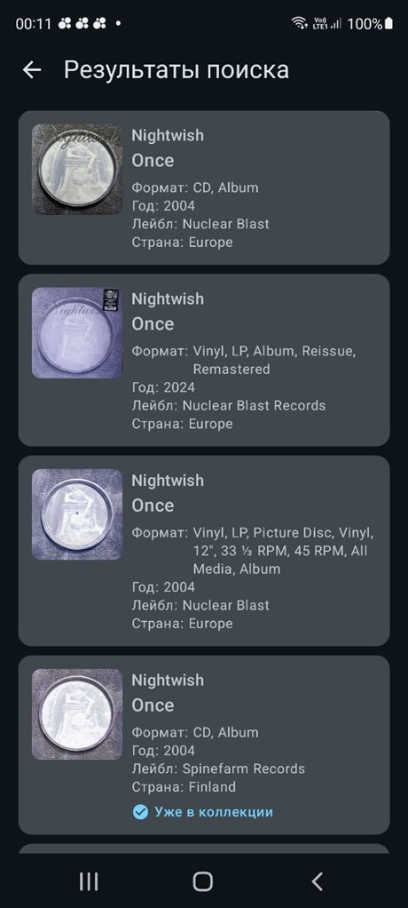 |
| Для дисков без штрихкода | Постраничная загрузка, бейдж «уже в коллекции» |

| Детали релиза | Треклист |
|:---:|:---:|
| 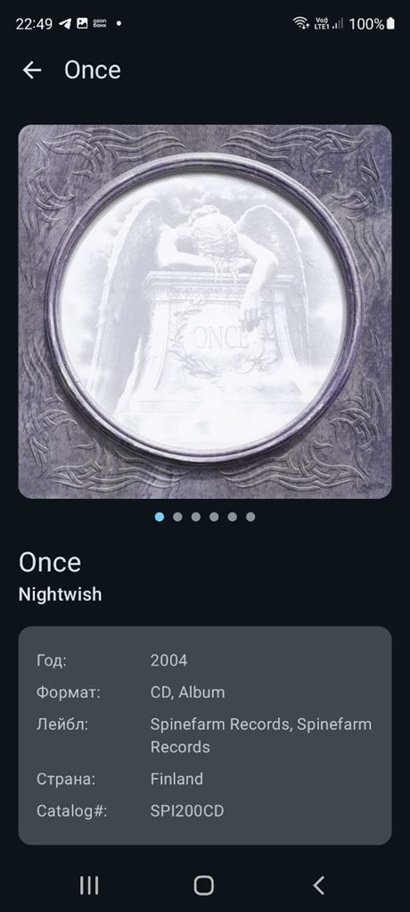 | 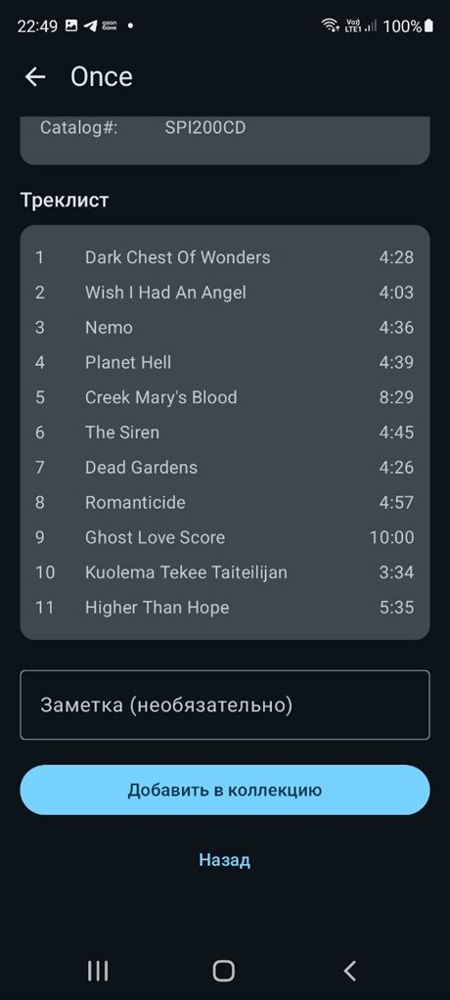 |
| Обложки, метаданные, добавление в коллекцию | Загружается по требованию |

| Добавление вручную | Поля и фотографии |
|:---:|:---:|
| 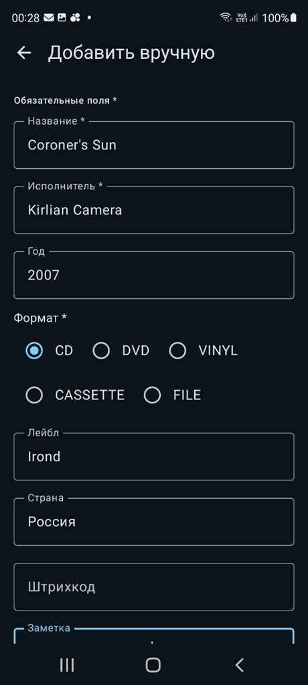 | 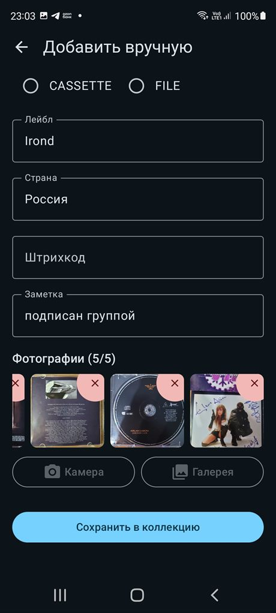 |
| Обязательные поля | Формат, лейбл, страна, штрихкод, заметка, до 5 фото |

| Кадрирование фото | Результат в коллекции |
|:---:|:---:|
| 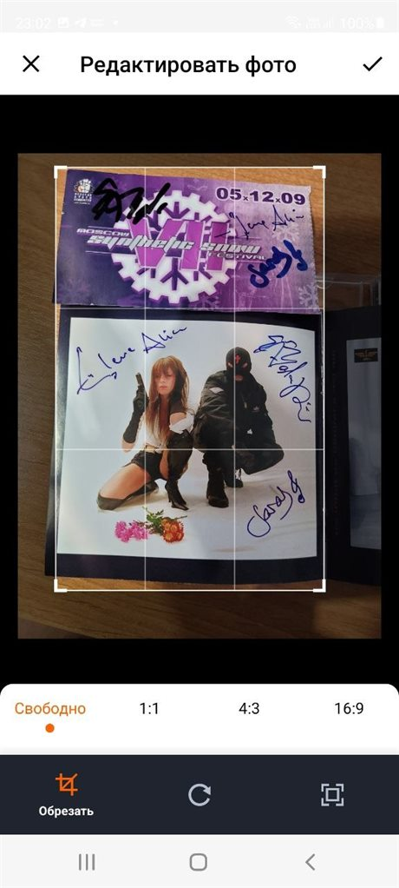 | 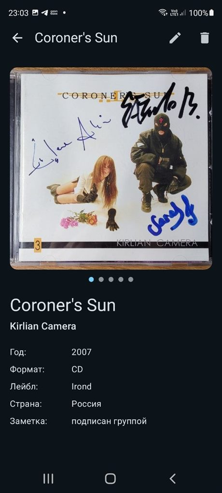 |
| Обрезка после съёмки или выбора из галереи | Карточка диска с подписанным буклетом |

### Моя коллекция

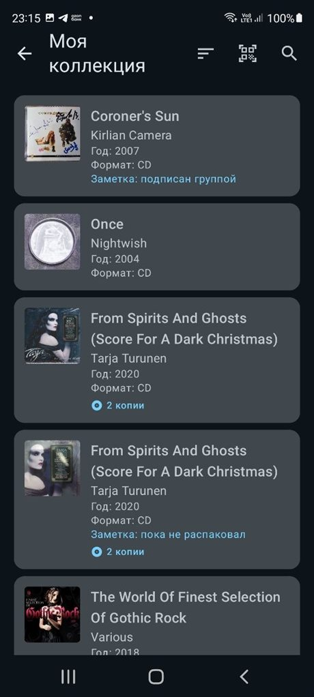

Постраничная загрузка, сортировка по дате/исполнителю/году, счётчик копий,
заметки пользователя.

## Сборка и запуск

1. Клонируйте репозиторий
2. Получите токен Discogs: [discogs.com/settings/developers](https://www.discogs.com/settings/developers)
3. Добавьте токен в `local.properties`:

   ```properties
   DISCOGS_TOKEN=ваш_токен
   ```

4. Соберите проект в Android Studio

```bash
./gradlew :app:assembleDebug      # сборка
./gradlew testDebugUnitTest       # юнит-тесты всех модулей
```

### Покрытие тестами

| Модуль | Что покрыто |
|---|---|
| `:domain` | `mergeWith`, форматирование, `DraftCollectionItem`, `DeleteCollectionItemUseCase` — 30 тестов |
| `:data:network` | `DiscogsSearchPagingSource` (дедупликация, отмена, ошибки) и мапперы DTO — 15 |
| `:data:database` | `CollectionRepositoryImpl`: маппинг в обе стороны, нормализация, ошибки БД — 15 |
| `:feature:add` | ViewModel-и ручного добавления, сканера и выбора результата — 26 |
| `:feature:collection` | `CollectionViewModel` (восстановление сортировки), `CollectionItemDetailViewModel` (удаление) — 10 |

Регрессионные тесты на два бага в маппинге проверены «введением обратно»:
при возврате дефекта падают ровно они, а не весь набор.

`:data:files` юнит-тестов не имеет: `AppPhotoStorageImpl` завязан на `Context`
и `FileProvider`, а провайдер объявлен в манифесте `:app`, так что
без Robolectric или инструментальных тестов его не проверить.

## Что дальше

- [x] Интеграция CameraX + ML Kit для сканирования
- [x] Room для локальной коллекции
- [x] Экран коллекции с сортировкой
- [x] Навигация между экранами
- [x] Paging 3 для локальной базы
- [x] Paging 3 для Discogs API
- [x] Единый конвейер доменных ошибок
- [x] Тесты `PagingSource` для сети (включая дедупликацию)
- [x] Общие блоки экранов деталей (`ReleaseInfo`) и общий топ-бар (`CdTopBar`) в `:common-ui`
- [x] Экспорт схемы Room и отказ от разрушительного отката при миграциях
- [x] Ориентация по размеру экрана: портрет на телефоне, свободная на планшете
- [x] Удаление фотографий вместе с записью коллекции
- [x] Сохранение фото в облаке и при переносе по кабелю
- [x] Сортировка и поисковый запрос переживают смерть процесса
- [ ] Адаптивность: многопанельные раскладки для планшетов
- [ ] Подготовка к публикации: включить R8, настроить подпись
- [ ] Экспорт коллекции

## Лицензия

MIT
