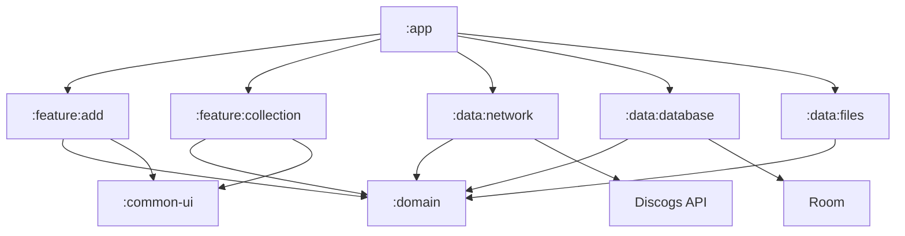

# CdVinylCatalog

Приложение-каталогизатор для личной коллекции CD, DVD, винила и аудиокассет.
Сканируйте штрихкод с диска — приложение найдёт релиз в базе Discogs
и покажет, есть ли он уже в вашей коллекции.

## Проблема

У меня имеется коллекция физических дисков и пластинок, но я не помню,
что именно у меня есть. Бывали случаи, когда я покупал диск в магазине,
а дома обнаруживал, что такой уже есть.

## Решение

1. Сканируете штрихкод с интересующего диска через камеру
2. Приложение ищет релиз в Discogs API
3. Показывает список изданий: исполнитель, альбом, год, формат
4. Помечает те издания, которые уже есть в вашей коллекции
5. Выбранный диск добавляется в локальную коллекцию

Если на диске нет штрихкода — есть ручной поиск по исполнителю и названию.
Если релиза нет в Discogs — его можно добавить вручную, с фотографиями обложки
и кадрированием.

## Технологии

- **Kotlin** + **Coroutines** + **Flow**
- **Jetpack Compose** — UI
- **MVI** — архитектурный паттерн (State / Intent / Effect)
- **Hilt** — dependency injection
- **Retrofit** + **OkHttp** + **Gson** — сеть
- **Room** — локальная база
- **Paging 3** — постраничная загрузка: и в Room, и в Discogs API
- **CameraX** + **ML Kit** — сканирование штрихкодов
- **Navigation Compose** — навигация
- **Coil** — загрузка обложек
- **uCrop** — кадрирование фотографий
- **Discogs API** — источник данных о релизах

## Архитектура

Проект построен на **фиче-ориентированной многомодульной архитектуре**
с **Clean Architecture** и разделением по слоям.

### Модули

```text
:app                    — точка входа, DI, навигация
:domain                 — Entities, порты репозиториев, Use Cases, AppError/Outcome
:data:network           — Retrofit, Discogs API, DTO, PagingSource, мапперы
:data:database          — Room, DAO, Entity, мапперы
:data:files             — реализация PhotoStorage: файлы фотографий, FileProvider
:common-ui              — тема, общие Compose-компоненты, UiMessage, маппинг AppError в текст
:feature:add            — сканирование, поиск, результаты, детали релиза, добавление вручную
:feature:collection     — коллекция: список с сортировкой и экран деталей
```

### Правила зависимостей

- Фичи зависят от `:domain` и `:common-ui`, но **не знают друг о друге**.
- `:domain` — чистый Kotlin-модуль (`java-library`), зависит от корутин,
  `paging-common` и `javax.inject`; никакого Android SDK.
- Реализации репозиториев живут в `:data:*`, интерфейсы — в `:domain`.
- Presentation-слой не знает о Retrofit, Room и сетевых исключениях.
- Если тип участвует в **публичном** API модуля (`Flow`, `PagingData`,
  `AppError`, `@Inject`), зависимость объявляется через `api(...)`, а не
  `implementation`, иначе потребитель не увидит эти типы при компиляции.
- Фичи не объявляют `:data:*` вообще — только `:domain` и `:common-ui`.
  Единственное место, где известны реализации, — `:app` (composition root).

### Что лежит в `:domain`

```text
:domain
├── catalog/       Entities: Release, Track, Format
├── collection/    Entities: CollectionItem, SortOrder
├── media/         PhotoDestination + порт PhotoStorage
├── result/        Outcome, AppError, AppErrorException
├── repository/    Порты: CollectionReader/Writer/Membership, ReleaseRepository
└── usecase/       Use Cases — единственное место для бизнес-логики
    ├── catalog/
    └── collection/
```

### Что лежит в `:common-ui`

```text
:common-ui
├── Theme.kt / Type.kt / Color.kt   Тема Material 3, динамические цвета
├── OrientationHandler.kt           Ориентация: портрет на телефоне, свободная на планшете
├── AppErrorExt.kt                  AppError → строка (asText)
├── message/                        UiMessage и маппинг AppError
└── component/
    ├── DiscCard.kt                 Карточка диска для всех списков
    ├── CoverGallery.kt             Галерея обложек с перелистыванием
    ├── CoverPlaceholder.kt         Заглушка, когда обложки нет
    ├── ReleaseInfo.kt              Обложки + заголовок + метаданные + треклист
    ├── ReleaseHeader.kt            Название и исполнитель
    ├── ReleaseMetadata.kt          Год, формат, лейбл, страна, каталог, заметка
    ├── MetadataRow.kt              Одна строка «лейбл — значение»
    ├── TracklistSection.kt         Секция треклиста в карточке
    ├── TrackRow.kt                 Один трек: позиция, название, длительность
    └── CdTopBar.kt                 Топ-бар: заголовок, «назад», действия
```

Общие экраны собираются из блоков, а не копируются:

- `ReleaseInfo` — общая часть обоих экранов деталей (релиз из Discogs
  и запись коллекции). Своё каждый экран добавляет хвостовым слотом:
  кнопки и заметку — `:feature:add`, «другие копии» — `:feature:collection`.
- `CdTopBar` заменяет `TopAppBar` с `navigationIcon` и `ArrowBack` на всех
  экранах; `onBack = null` — экран без кнопки «назад».

В блоках экранов деталей стиль фиксирован, а не параметризуется: в `ReleaseInfo`
нет `titleStyle` или `inCards`. Настройка — сам набор переданных полей
(передано — рисуется, `null` — пропускается), без флагов вида
`showLabel`/`showCountry`. Иначе два экрана одного назначения снова
разъезжаются по стилю. Размер обложки в `DiscCard` — осознанное исключение:
в поиске нужна крупнее, в коллекции компактнее.




### MVI

Каждая фича следует MVI:

- **State** — единый неизменяемый снимок UI
- **Intent** — действия пользователя
- **Effect** — одноразовые события (Toast, навигация)

`PagingData` живёт **вне** State: это бесконечный поток, его нельзя класть
в `data class` состояния. Он выносится отдельным `StateFlow` и собирается
в UI через `collectAsLazyPagingItems()`.

### Обработка ошибок

Единый конвейер, одинаковый для обычных запросов и для пагинации:

```text
Исключение (UnknownHostException, HttpException, ...)
        │
        ▼   mapExceptionToAppError()  — единственное место маппинга, :data:network
   AppError (sealed interface в :domain)
        │
        ▼   AppErrorException — транспортная обёртка для Paging 3
LoadResult.Error / Outcome.Failure
        │
        ▼   asText(context)  — маппинг в строки, :common-ui
      Текст для пользователя
```

Presentation-слой оперирует только `AppError` и строковыми ресурсами,
поэтому замена Discogs на другой источник данных не затронет UI.

### Пагинация

- **Локальная коллекция** — `Room` отдаёт `PagingSource` напрямую, `Pager`
  создаётся в `CollectionRepositoryImpl`. Смена сортировки пересоздаёт
  `PagingSource` через `flatMapLatest`.
- **Сеть** — `DiscogsSearchPagingSource` параметризован штрихкодом или
  поисковой строкой и использует блок `pagination` из ответа Discogs,
  чтобы не делать лишний запрос за пределами последней страницы.
  Поиск Discogs умеет возвращать один и тот же релиз несколько раз, поэтому
  источник дедуплицирует результаты по `release.id` (иначе падает
  `LazyColumn`, у которого ключ — ID релиза).
- Потоки кэшируются в `viewModelScope` (`cachedIn`), поэтому поворот экрана
  не приводит к повторной загрузке.

### Навигация

Результаты поиска передаются между экранами **аргументами маршрута**
(`selection/{source}/{query}`), а не через общее состояние. Это переживает
поворот экрана и восстановление процесса. Сам поиск выполняется
в `ReleaseSelectionViewModel` — экраны сканера и ручного поиска только
передают строку запроса.

## Скриншоты

| Главный экран | Сканирование |
|:---:|:---:|
|  |  |
| Точка входа: сканер, поиск, ручное добавление, коллекция | Штрихкод распознаётся камерой через ML Kit |

| Ручной поиск | Результаты из Discogs |
|:---:|:---:|
|  |  |
| Для дисков без штрихкода | Постраничная загрузка, бейдж «уже в коллекции» |

| Детали релиза | Треклист |
|:---:|:---:|
|  |  |
| Обложки, метаданные, добавление в коллекцию | Загружается по требованию |

| Добавление вручную | Поля и фотографии |
|:---:|:---:|
|  |  |
| Обязательные поля | Формат, лейбл, страна, штрихкод, заметка, до 5 фото |

| Кадрирование фото | Результат в коллекции |
|:---:|:---:|
|  |  |
| Обрезка после съёмки или выбора из галереи | Карточка диска с подписанным буклетом |

### Моя коллекция


Постраничная загрузка, сортировка по дате/исполнителю/году, счётчик копий,
заметки пользователя.

## Сборка и запуск

1. Клонируйте репозиторий
2. Получите токен Discogs: [discogs.com/settings/developers](https://www.discogs.com/settings/developers)
3. Добавьте токен в `local.properties`:

   ```properties
   DISCOGS_TOKEN=ваш_токен
   ```

4. Соберите проект в Android Studio

```bash
./gradlew :app:assembleDebug      # сборка
./gradlew testDebugUnitTest       # юнит-тесты всех модулей
```

## Что дальше

- [x] Интеграция CameraX + ML Kit для сканирования
- [x] Room для локальной коллекции
- [x] Экран коллекции с сортировкой
- [x] Навигация между экранами
- [x] Вынос строк в `strings.xml`
- [x] Paging 3 для локальной базы
- [x] Paging 3 для Discogs API
- [x] Единый конвейер доменных ошибок
- [x] Тесты `PagingSource` для сети (включая дедупликацию)
- [x] Чистка зависимостей: фичи больше не тянут `:data:*`,
      `:domain` и `:common-ui` отдают свои публичные API через `api(...)`
- [x] Общие блоки экранов деталей (`ReleaseInfo`) и общий топ-бар (`CdTopBar`) в `:common-ui`
- [ ] Адаптивность: планшеты и ландшафт
- [ ] Экспорт коллекции

## Лицензия

MIT
